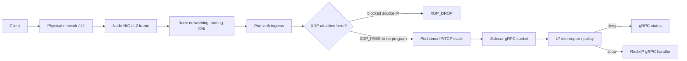

# Network Layers, Packet Flow, and RadixIP

This guide introduces the OSI model as a way to reason about network traffic, then follows a request through a typical RadixIP deployment. It connects the physical network, Linux packet processing, eBPF/XDP, Kubernetes pod networking, gRPC sidecars, Redis, and the RadixIP policy engine.

The OSI model is a teaching model, not a strict map of software modules. Real protocols often span layers, and the TCP/IP model groups some OSI layers together. The useful question is: **what information is visible at this point, and what work has already happened?**

## The Seven Layers

| OSI layer | Name | Typical data or protocols | Useful mental model |
|---|---|---|---|
| 7 | Application | HTTP, gRPC, DNS, SMTP | What the application is asking to do |
| 6 | Presentation | TLS encryption, character encodings, serialization formats | How application data is represented or protected |
| 5 | Session | Session setup, continuation, and teardown concepts | How application conversations are maintained |
| 4 | Transport | TCP, UDP; ports; connection state | Which process/service receives data and how delivery works |
| 3 | Network | IPv4, IPv6; source/destination IP; routing | Which host or network should receive a packet |
| 2 | Data link | Ethernet, MAC addresses, VLAN tags | How a frame moves across one local link |
| 1 | Physical | Copper, fiber, radio, optics, electrical/optical signals | How bits cross a physical medium |

On a typical Ethernet request, data is encapsulated as it moves down the sender's stack:

```text
Application data
  inside HTTP/2 or another application protocol
  inside TCP or UDP (transport header, including ports)
  inside IPv4 or IPv6 (network header, including IP addresses)
  inside Ethernet (link header, including MAC addresses and EtherType)
  transmitted as physical signals
```

The receiver processes the layers in reverse. Each layer removes or interprets its own header before passing data upward. A layer-3 IP address is not the same thing as a layer-2 MAC address, and neither is the same thing as an application identity such as a gRPC method or authenticated user.

## What RadixIP Can See

RadixIP has enforcement at two different points. They answer different questions and have different costs:

| Enforcement point | Information available | Decision | What has already happened? |
|---|---|---|---|
| XDP program | Ethernet EtherType and IPv4/IPv6 source address | Drop or pass a packet | The frame reached the interface; in native mode it can be before `sk_buff` allocation. No TCP connection or gRPC request is required. |
| gRPC interceptor / policy middleware | gRPC metadata, peer address, and sometimes HTTP/2 request context | Allow RPC, return a gRPC status, or apply rate policy | The packet traversed the kernel networking stack, TCP was established, and HTTP/2/gRPC processing reached the service. |
| Application handler | RPC method and decoded protobuf request | Perform the requested operation | The request passed earlier gates and was decoded for the handler. |

XDP is an early packet gate. A match returns `XDP_DROP`, so that packet does not continue through the ordinary receive path. It does not send an HTTP or gRPC rejection response; the sender may observe a timeout or transport-level failure.

A gRPC interceptor rejects an RPC, not a raw packet. It can return statuses such as `PermissionDenied` or `ResourceExhausted`, but the connection and request have already consumed network and application resources.

These are complementary controls: XDP can cheaply discard known-bad source addresses; L7 policy can reason about request context that does not exist in a raw packet.

## A Packet Through a Kubernetes Pod

The diagram shows a common pod-network ingress path. Exact details vary by CNI, kernel, load balancer, service mesh, and whether XDP is attached to the pod veth or a node interface.



Containers in the same pod share a network namespace. The application can call the sidecar over the pod's loopback interface, for example `127.0.0.1:50052` for the Rust sidecar or `127.0.0.1:50051` for Go. That local RPC still uses the kernel's local networking path, but it does not arrive from the pod veth like external ingress traffic. Attaching XDP to pod `eth0` is therefore not a way to inspect gRPC method names or to filter only calls to the sidecar; it is an interface-level packet hook.

If the sidecar is attached to a node NIC instead, it can affect traffic for more than one pod and may conflict with an XDP program installed by the CNI. The attach point and ownership must be an explicit deployment decision.

## OSI Layers in a RadixIP Deployment

### Layer 1: Physical

The NIC, cable, optics, and wireless medium transmit bits. RadixIP does not inspect electrical or optical signals. Hardware failures, link negotiation, and signal quality are below the RadixIP policy engine.

### Layer 2: Data Link

Ethernet frames carry MAC addresses, an EtherType, and optionally VLAN tags. The current XDP program starts here: it checks the EtherType and supports an untagged frame or one 802.1Q/802.1ad VLAN tag. It does not perform general switching or parse arbitrary VLAN stacks. Unknown protocols are passed.

In XDP native/driver mode, the program runs in the NIC driver's receive path. Generic/SKB mode runs later, after `sk_buff` allocation, but still before normal IP/TCP processing. Native mode can avoid more work, but needs compatible hardware/driver support and is not guaranteed in a pod veth environment.

### Layer 3: Network

IPv4 and IPv6 headers provide source and destination IP addresses. The current kernel program reads the source address and looks it up in separate IPv4 and IPv6 LPM tries. A stored CIDR such as `198.51.100.0/24` can match any source address in that prefix. The source bytes are compared in network order.

On a match, the program returns `XDP_DROP`; otherwise it returns `XDP_PASS`. Truncated or unrecognized frames fail open and pass. The program currently does **source-IP blocklisting only**; it does not perform routing decisions or inspect destination IP policy.

The address XDP sees is the address present at its attach point. A load balancer, SNAT, kube-proxy, or proxy may have changed the source address before the packet reaches that point. Verify the observed source address before enabling broad policies. HTTP `X-Forwarded-For` and gRPC metadata do not change the packet's IP header and are invisible to XDP.

### Layer 4: Transport

TCP and UDP add ports and transport behavior. TCP establishes a connection and retransmits lost data; UDP does not. A gRPC call normally uses HTTP/2 over TCP, optionally protected by TLS.

The current XDP implementation does **not** parse TCP/UDP headers, match ports, or apply L4 rate limits. Those are possible future extensions, but require additional packet parsing, map design, tests, and an explicit policy contract. Do not describe the current blocklist as an L3/L4 filter: it is an L3 source-IP decision made at an XDP hook that receives L2 frames.

### Layers 5 and 6: Session and Presentation

These layers are useful concepts for connection lifetime, data representation, and encryption. In deployed stacks their responsibilities are spread across TCP, TLS libraries, HTTP/2 implementations, and application frameworks rather than appearing as clean independent modules.

XDP runs before a TCP connection or TLS session is available. It cannot inspect TLS plaintext, certificates as presented to the application, protobuf fields, or gRPC metadata. If TLS terminates at a proxy before the RadixIP gRPC sidecar, the proxy and its trust configuration determine which client identity reaches L7 policy.

### Layer 7: Application

gRPC is an application protocol built on HTTP/2 and protobuf. The Go and Rust sidecars expose RadixIP gRPC services and can apply policy at the RPC boundary. Their middleware can extract client identity from gRPC metadata such as `x-forwarded-for` / `x-real-ip` and from the peer address, then evaluate configured policy and return an application-level status.

L7 has richer context than XDP, but it is later in the path. It is the right place for method-aware decisions, metadata, tenants, authentication context, and business policy. It is not a substitute for an early packet drop when the goal is to avoid delivering known-bad traffic to the stack.

## RadixIP Components and Responsibilities

```text
L7 policy decision / trusted admin or detection system
             │
             ├── gRPC request path ──► interceptor ──► ART/policy ──► status or handler
             │
             └── flagged-IP feed ──► Redis channel + snapshot
                                           │
                                           ▼
                                  embedded XDP loader
                                           │ update LPM map
                                           ▼
Ingress frame ──► XDP program ──► XDP_DROP or XDP_PASS
```

- **ART engine:** in-process longest-prefix matching and metadata storage. It is a userspace data structure, not an XDP program.
- **gRPC sidecar:** a process in the pod serving RadixIP RPCs and, when configured, running application-layer interceptors. The application can call it over localhost.
- **Redis:** coordination and distribution. The eBPF program does not connect to Redis; userspace loader code consumes updates and changes kernel maps.
- **eBPF/XDP program:** a small verified packet program that reads packet headers and consults kernel maps on ingress.
- **Kubernetes operator:** reconciles `RateLimiterPolicy` resources, loads the rate-limit Lua script into Redis, inventories targeted pods, and updates policy status/events. The current controller checks for a container named `radixip-rate-limiter`; it does not itself attach XDP or inject the sidecar.
- **Helm/sample workload:** the chart can configure a sidecar image/flavor and its YAML, and the sample workload explicitly places the sidecar beside the application. The chart's injector settings are not proof that a mutating admission webhook is currently performing injection.

## Current Go and Rust XDP Paths

Both implementations are opt-in through `radixip.xdp.enabled`, and both are intended to fail open when loading or attachment is unavailable. Their general lifecycle is:

1. Load the eBPF object and create or reuse pinned maps.
2. Subscribe to the configured Redis channel.
3. Read the configured Redis set snapshot and seed the maps.
4. Attach the program to the configured interface.
5. Apply live add/delete messages to maps until shutdown.

The Go sidecar uses `lib/go/xdp` with Cilium eBPF and a C object generated by `bpf2go`. The Rust gRPC sidecar calls the reusable Aya API in `ebpf/xdp-loader`; the kernel program is built separately and embedded into the userspace binary. Both loaders normalize IPv4-mapped IPv6 entries and reject overly broad or operator-protected prefixes.

The Redis blocklist feed is a separate control-plane contract. The current loader scaffolds assume a snapshot set containing IP/CIDR strings and channel messages shaped like `add <cidr>` or `del <cidr>`. Channel names and snapshot keys are configurable. Generic gRPC `Insert` calls store ART prefixes; they are **not automatically equivalent to an instruction to drop packets**. Only explicit flagged/blocklist events should be mirrored into XDP. The producer, snapshot writer, and both loaders must agree on message format, expiry/deletion behavior, and ownership before this is treated as an end-to-end production pipeline.

### Kubernetes prerequisites and limits

XDP is disabled by default. To enable it in Kubernetes, an operator must deliberately provide a compatible interface, the required kernel/BPF privileges, and bpffs access when pinning is enabled. The current Helm security defaults run as non-root and drop all capabilities, and the sidecar container template does not by itself mount bpffs or grant XDP capabilities. Thus setting only `xdp.enabled: true` is not sufficient; the loader can fail open to userspace-only filtering.

Also consider:

- **Pod interface vs node interface:** a pod-sidecar attach typically targets the pod network namespace's `eth0`; a DaemonSet targeting a node NIC has a wider blast radius.
- **CNI ownership:** Cilium or another networking component may already own the node NIC's XDP attachment.
- **Client identity:** XDP sees packet source IP at its hook; L7 sees peer/forwarded metadata after proxies. These identities can differ.
- **Fail-open visibility:** monitor whether XDP actually attached and whether the map is seeded. A healthy gRPC process does not prove XDP is enforcing.
- **Shutdown and pinning:** the current link is process-owned and detaches on close. Pinned maps can survive restarts, so stale entries need a reconciliation strategy.

## Performance and Benchmarking

Do not compare ART lookup nanoseconds directly with an XDP packet-drop measurement as if they were the same operation. ART timing measures a userspace lookup; XDP timing includes a packet hook and map lookup; L7 rejection includes transport, HTTP/2/gRPC, IP extraction, and policy work.

A meaningful experiment uses the same clients, blocked sources, traffic mix, host, and duration, then compares:

1. L7-only rejection by the gRPC interceptor.
2. XDP generic/SKB source-IP drop before the application stack.
3. XDP native/driver mode where the NIC and deployment support it.

Measure application-visible bad requests, accepted good-client throughput, p50/p99 latency for good traffic, CPU utilization, and XDP drop/pass counters. For dropped TCP packets, client timeouts/retransmissions are not the time taken by the XDP decision. Use packet counters or a controlled packet generator for drop throughput. Run correctness tests in normal CI; collect performance numbers only on a stable Linux runner with the required privileges and documented NIC/kernel/CNI details.

### Hardware NIC Drivers & Automatic Fallback (Intel e1000e vs Server NICs)

Not all physical NICs implement the `ndo_bpf` driver hook required for Native Driver XDP (`XDP_FLAGS_DRV_MODE`):

- **Consumer & Laptop NICs (e.g. Intel I219-LM / I219-V on HP EliteBook 840 G3):** Driven by the Linux **`e1000e`** driver. Upstream `e1000e` does **not** implement native XDP. Attempting to attach in native mode returns `EOPNOTSUPP` / `ENOTSUPP`.
- **Wireless NICs (e.g. Intel Dual Band Wireless-AC 8260 / `iwlwifi`):** No wireless drivers support native XDP.
- **Server NICs (e.g. Intel `ixgbe`, `i40e`, `ice`, Mellanox `mlx5_core`):** Support full native XDP offload before socket allocation.

To handle this transparently, RadixIP provides an **automatic fallback mechanism** (`RADIXIP_XDP_MODE="auto"` or `AutoMode: true`):
1. The loader attempts Native Driver Mode (`link.XDPDriverMode` / `XdpFlags::DRV_MODE`).
2. If unsupported by the interface driver, it automatically falls back to Generic SKB Mode (`link.XDPGenericMode` / `XdpFlags::SKB_MODE`).
3. The server logs the effective attachment mode and continues operating without failing open or crashing.

### Local Testing vs. Virtualized CI Runners

Benchmarking XDP on shared or virtualized runners (such as GitHub Actions Ubuntu runners on Azure VMs) presents distinct challenges:
- **Synthetic NICs:** Cloud runners use virtualized network devices (such as Hyper-V `hv_netvsc` or VirtIO without driver XDP hooks), which only support Generic SKB mode.
- **Shared CPU Cores:** Multi-tenant virtualization introduces scheduling jitter and noisy-neighbor latency artifacts.
- **Host Link Risk:** Attaching an XDP program directly to the primary host interface in CI or on a developer workstation risks dropping SSH or network traffic.

**The Solution:** RadixIP uses **isolated Linux network namespaces (`netns`) and virtual ethernet (`veth`) pairs** via `scripts/bench_xdp_vs_l7.sh`:
- Virtual ethernet (`veth`) supports **both Native Driver Mode and Generic SKB Mode** in modern Linux kernels.
- The entire benchmark executes inside an isolated sandbox, leaving host interfaces, WiFi, and SSH completely unaffected.
- Any Linux user (e.g., Fedora Workstation, Ubuntu) can run `sudo ./scripts/bench_xdp_vs_l7.sh` for an identical, 100% reproducible comparison of L7 vs L2/L3 packet blocking.

## Learn More

- [eBPF and XDP integration details](./ebpf-xdp-integration.md)
- [RadixIP Kubernetes operator](../../deploy/operator/README.md)
- [Middleware and gRPC policy behavior](../middleware.md)
- [Network-layer packet processing in Linux](https://docs.kernel.org/networking/)
- [eBPF documentation](https://docs.ebpf.io/)